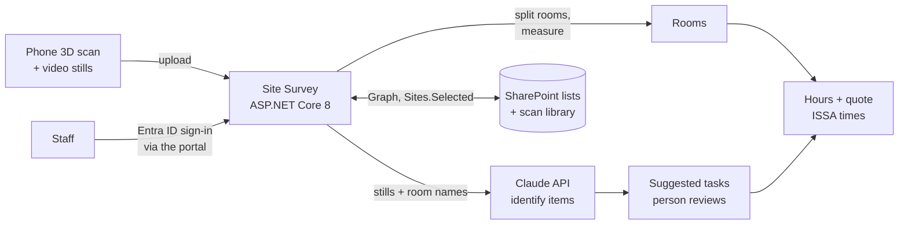

# Site Survey Tool

> An internal web tool that turns a phone's 3D room scan into room-by-room measurements, suggested cleaning tasks and a labor-hours quote for janitorial bids.

**Built for:** a ~150-employee facility services franchise (3 offices), where I'm the sole IT person
**When:** October 2026, live
**Stack:** C# / ASP.NET Core 8 (Razor Pages) · Microsoft.Identity.Web · Microsoft Entra ID · SharePoint Lists and a document library via Microsoft Graph (`Sites.Selected`) · Claude API (vision, structured output) · PowerShell (PnP.PowerShell) setup scripts · Docker · Render · xUnit
**My role:** Designed, tested and deployed it. Built with Claude Code as an AI pair programmer.

> The source code belongs to my employer and stays private. This page describes what I built and how.

---

## The problem

To bid a cleaning contract, someone walks the building, measures every room, works out what needs cleaning and how often, and turns that into hours and a price. That was tape measures, notes and a spreadsheet. Measurements were slow to take, and the hours behind a bid were hard to check later.

## What it does

- **Properties and surveys.** Each property holds surveys; each survey holds its scans, its rooms and their tasks. Every change is written to a change log.
- **Room scans to measurements.** Upload a 3D scan exported from a phone scanning app (a zipped `.dae` mesh). The tool finds the floor and the main ceiling, then works out each room's floor area, length × width, ceiling height, perimeter and wall area.
- **Whole-area scans split into rooms.** One scan can cover several rooms. The tool splits it at the walls above door height and at doorway-width pinches, then shows a numbered plan with a card per room. The reviewer ticks the rooms in scope, names them and corrects anything wrong. Small pieces, usually floor seen through a doorway, start unticked.
- **Suggested tasks from photos.** The upload page pulls 12 still frames from the scanner's video in the browser and uploads only those; the video itself is never stored. Claude identifies the floor type and counts fixtures per room, using only item names from a fixed catalog. Editable templates turn those items into suggested cleaning tasks, and a person ticks which ones to add. Low-confidence items start unticked.
- **Hours and quote.** Each task links to an industry cleaning-time standard (ISSA 540). The tool totals monthly labor hours per room and per survey, and admins see the price from the company's pricing formula. Admins can edit any time standard; the original book time is kept and can be restored.
- **Three roles.** Viewer, Surveyor and Admin. Everyone sees hours; only Admins see money.

## Design rules

- **AI identifies, code calculates.** The model only names items from a fixed catalog and counts them. Every hour and dollar comes from tested C# code, and nothing reaches a quote until a person ticks it.
- **Imported numbers are reviewed before pricing.** Measurements from a scan are shown for confirmation, never priced straight from the file.
- **Pay for identification once.** The model's answer is saved next to the frames, so reopening a survey doesn't call the API again.
- **Least privilege.** Two Entra app registrations: one for sign-in and roles, one app-only data app granted `Sites.Selected` on a single SharePoint site. The app checks roles itself; the [portal](https://github.com/Matteoinfl/internal-tools-sso-portal) tile is only a convenience.
- **Licensed data stays out of git.** The cleaning-time tables are licensed, so a PowerShell script imports them into SharePoint. Re-running the import never overwrites a time an Admin has edited unless told to.
- **Setup is scripted.** PowerShell scripts create both Entra apps (no secrets in the script), the SharePoint site, lists and library, grant access, and run a verify pass.

## Results

- **Live** on the company's internal tools portal behind Entra sign-in. Checked on the live server: sign-in through the portal tile, and an account with no role gets the access-denied page.
- **First real scan (an office lobby, rest area and restroom):** split into three rooms that matched the real spaces, plus three doorway glimpses correctly left out of scope.
- **Quote math verified by hand:** a test room and task gave the same hours and price as a hand calculation, and editing the time standard then restoring the book time worked end to end against live SharePoint.
- **Scan-to-quote trial:** from 12 stored frames, the tool proposed 29 tasks across three rooms; 27 were kept after review.
- About 40 automated tests (room estimator, room splitting, quote calculator, task suggestions).

## Problems I found and fixed

- **A 1.7 GB memory spike on a 512 MB server.** The first real scan was a 122 MB mesh with 1.89 million triangles. I rewrote the reader to stream numbers in chunks and keep only what the measurements need, which brought it to about 150 MB. A second pass (exact-size arrays, rotating the mesh in place) cut the room-splitting step from 349 MB to 133 MB allocated. Uploads are also capped, and a zip's unzipped size is checked from its header before reading.
- **A two-story entry read as the ceiling.** The first ceiling rule took the highest part of the scan, so a small two-story area made a 21 ft "ceiling" and more than doubled the wall area. Now the main ceiling is the largest flat level above the floor, and any higher open area is reported separately with its size.
- **Fixtures you can't count from a 3D model.** The scan's texture is too patchy to count toilets or sinks (top-down, wall and dollhouse renders all failed), so identification switched to video stills taken in the browser.
- **Graph file search fails under `Sites.Selected`.** App-only search isn't allowed with that permission, so files are looked up by path instead.
- **Pages squeezed into a narrow column.** A stylesheet comment left unclosed while copying from another internal tool swallowed the layout rule. Found and fixed, then checked at phone and desktop widths.

## Planned

- Import a commercial LiDAR scanning app's room report directly, once a sample export is available
- Turn on the in-app API call for item identification (the trial ran the identification step outside the app, in the app's own format)

---

*Part of a set of internal tools I built for the same company. See my [profile](https://github.com/Matteoinfl) for the others.*
